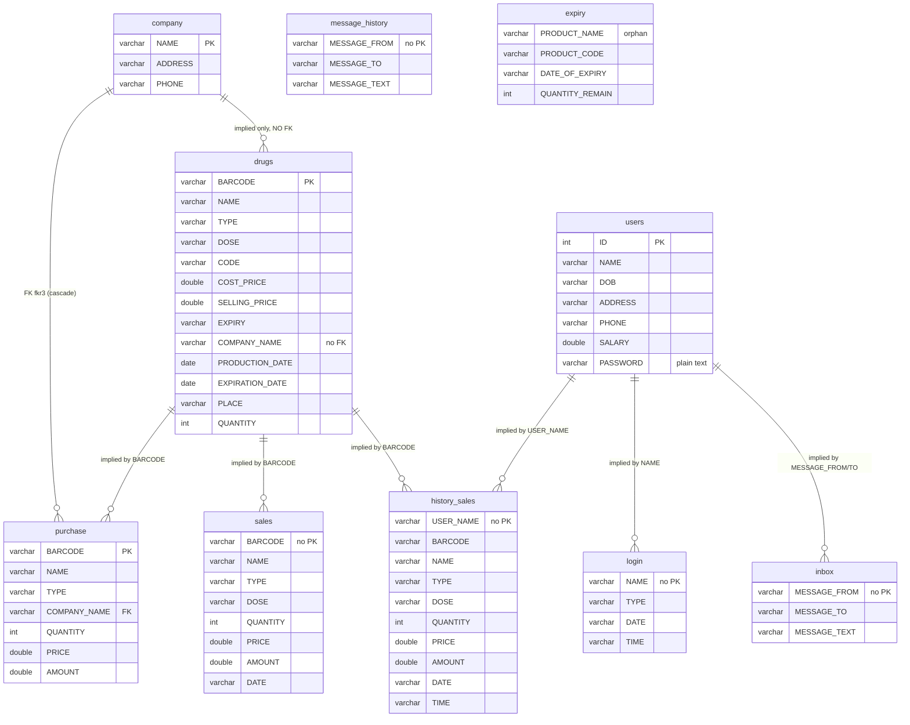
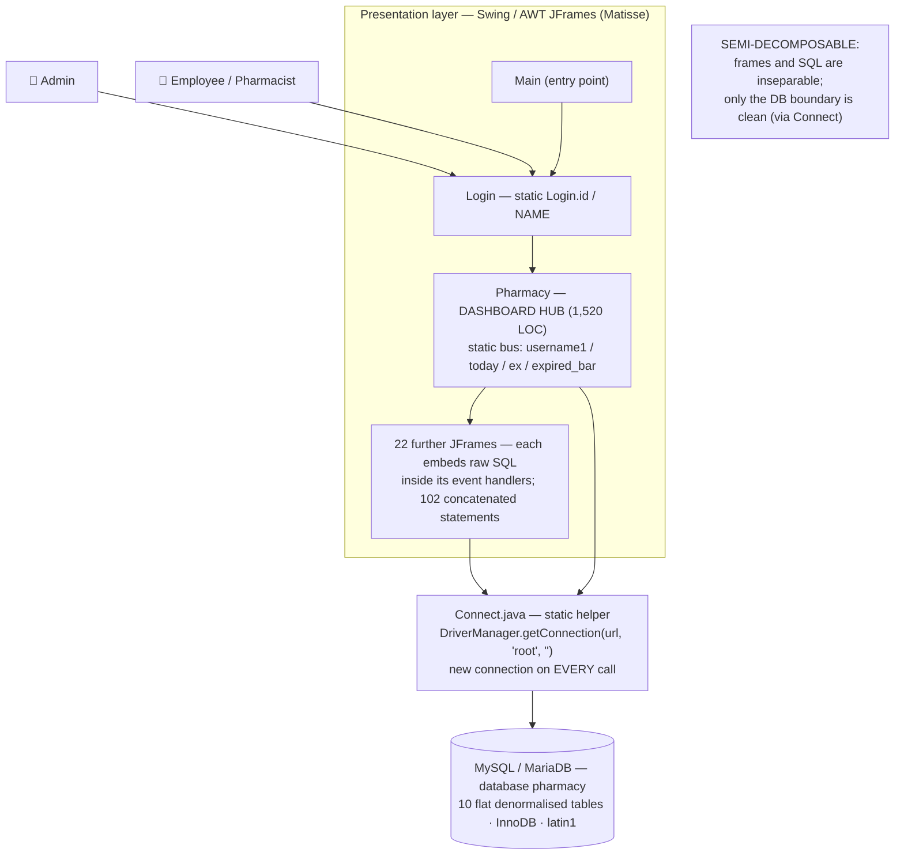
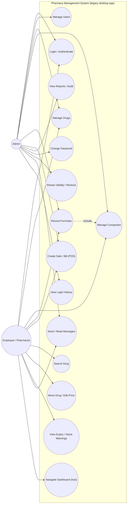
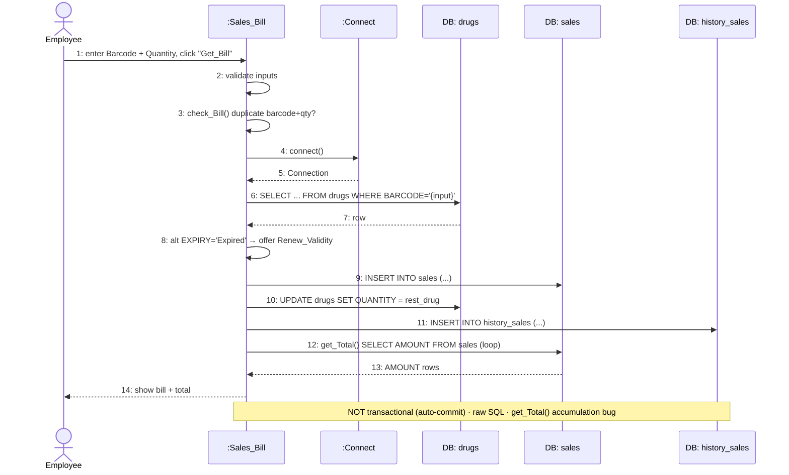
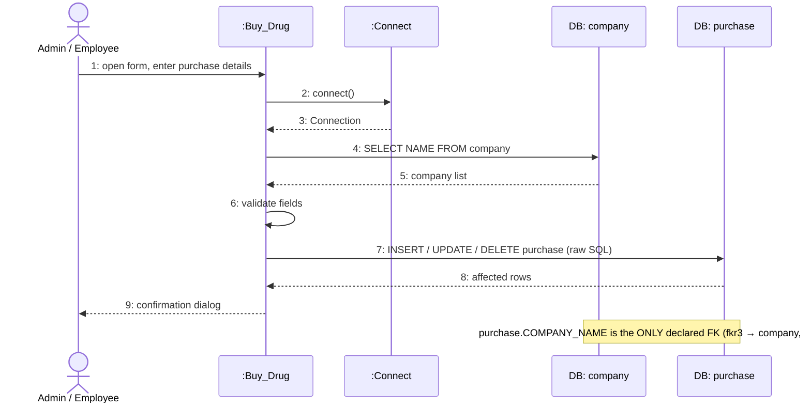
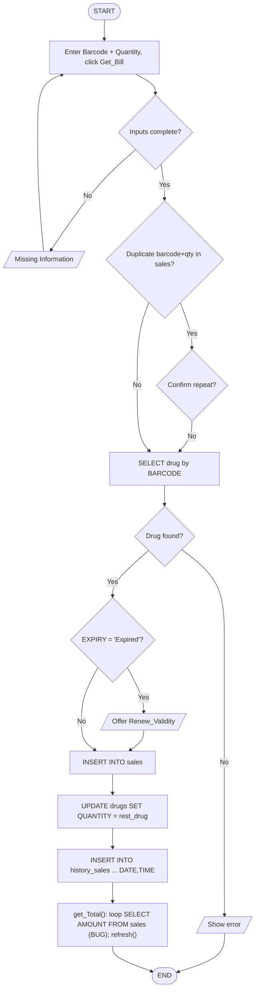
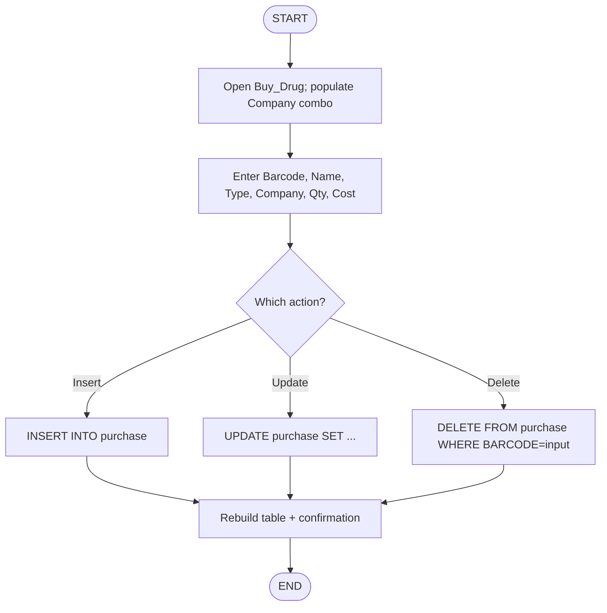
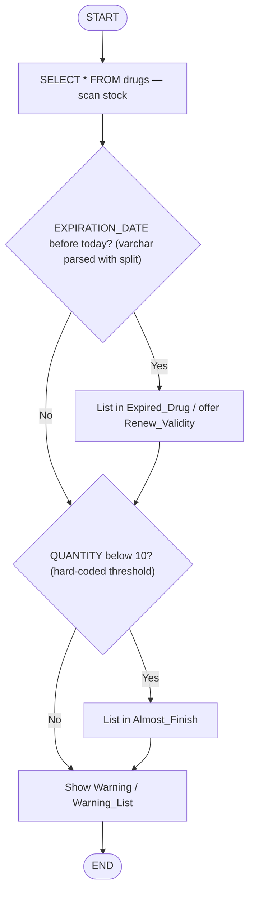
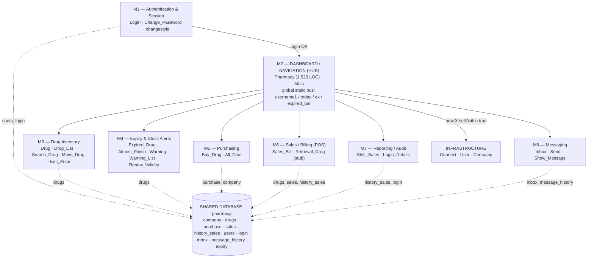

# Current-System Diagram Pack — Pharmacy Management System

Complete set of **as-is (current system)** diagrams for the Pharmacy Management System,
recovered by reverse engineering the legacy 2-tier Swing application and its `pharmacy` database.

> All facts are taken from the actual source (`src/main/*.java`), the database dump
> (`../../../pharmacy.sql`) and the recovered design in `../../Design_Document.md`.

## Files in this folder

| # | File | Diagram | What it shows |
|---|------|---------|---------------|
| 1 | `01_database_schema_diagram.drawio` | **Database schema (tables)** | The 10 legacy tables, PK/FK, the only real FK, and schema problems |
| 2 | `02_current_system_diagram.drawio` | **Current system diagram** | As-is 2-tier monolith: users → frames → `Connect` → MySQL |
| 3 | `03_use_case_diagram.drawio` | **Use-case diagram** | Actors (Admin, Employee) and the 15 recovered use cases |
| 4 | `04_sequence_diagram.drawio` | **Sequence diagram** | 3 pages: Login, Create Sale/Bill, Record Purchase |
| 5 | `05_flowcharts.drawio` | **Flowcharts** | 4 pages: Login, Sale, Purchase, Expiry/Stock warnings |
| 6 | `06_module_diagram.drawio` | **Module diagram** | How modules M1–M8 connect through the hub and share the DB |

### How to open the `.drawio` files
- **Web:** <https://app.diagrams.net> → *Open Existing Diagram* → pick the file.
- **Desktop:** draw.io Desktop.
- **VS Code:** the *Draw.io Integration* extension (double-click the file).
- **Export:** from diagrams.net export to PNG / SVG / PDF for your report.
- Files are plain XML and also open in any text editor.

The same diagrams are reproduced below as **Mermaid** so they render directly on GitHub.

---

## 1. Database Schema Diagram (current / legacy — tables)



**Problems:** denormalisation (name/type/dose/price copied into sales/purchase/history_sales) ·
no PK on `sales`, `history_sales`, `login`, `inbox`, `message_history` ·
`drugs.COMPANY_NAME` has no FK · dates stored as `varchar` · plain-text passwords ·
duplicate `inbox` = `message_history` · orphan `expiry` · `latin1` encoding.

---

## 2. Current System Diagram (as-is architecture)



---

## 3. Use-Case Diagram (current system)



---

## 4. Sequence Diagrams (current system)

### 4a. Login / Authenticate

```mermaid
sequenceDiagram
    actor U as User (Admin/Employee)
    participant L as :Login (JFrame)
    participant C as :Connect (static helper)
    participant DB as MySQL: users
    participant P as :Pharmacy (dashboard)

    U->>L: 1: enter ID & Password, click "Login"
    L->>L: 2: validate fields not empty
    L->>C: 3: connect()
    C->>DB: 4: getConnection(jdbc:mysql://localhost/pharmacy, "root", "")
    DB-->>C: 5: Connection
    C-->>L: 6: Connection con
    L->>DB: 7: SELECT ID,NAME,PASSWORD FROM users WHERE ID='{input}'  (string concat!)
    DB-->>L: 8: ResultSet
    L->>L: 9: compare PASSWORD (plain text)
    alt password OK
        L->>P: 10: new Pharmacy(); dispose()
        P-->>U: 11: show dashboard
    else wrong
        L-->>U: 12: "Wrong Password" / "Wrong ID"
    end
    Note over L,DB: SQL injection · plain-text password · identical if/else branches · connection per frame
```

### 4b. Create Sale / Bill (POS)



### 4c. Record Purchase



---

## 5. Flowcharts (current system)

### 5a. Login

```mermaid
flowchart TD
    S([START]) --> A[Enter User_ID and Password, click Login]
    A --> D1{Fields empty?}
    D1 -- Yes --> I1[/Show "Complete Your Login Information"/] --> A
    D1 -- No --> Q[SELECT ID,NAME,PASSWORD FROM users<br/>WHERE ID = input]
    Q --> D2{Row with this ID found?}
    D2 -- No --> I2[/Show "Wrong ID"/] --> E([END])
    D2 -- Yes --> D3{Password matches?}
    D3 -- No --> I3[/Show "Wrong Password"/] --> E
    D3 -- Yes --> P[NAME = res.NAME; new Pharmacy();<br/>dispose(); show dashboard] --> E
```

### 5b. Create Sale / Bill (POS)



### 5c. Record Purchase



### 5d. Expiry & Stock Warnings (M4)



---

## 6. Module Diagram (how modules are connected)



**Reading it:** all navigation radiates from the `Pharmacy` hub (star topology); every module
talks straight to its own tables (no shared data layer); the global `static` field bus couples
the frames → the hub carries the system's highest coupling (Henry–Kafura `Cp`).

---

## Summary of the current system

| Aspect | Current (as-is) state |
|---|---|
| Architecture | 2-tier Java SE desktop monolith (Swing), no service/DAO/domain layers |
| Decomposability | Semi-decomposable — clean seam only at the DB boundary (`Connect.java`) |
| Modules | 8 recovered functional modules M1–M8 + infrastructure, coupled via the `Pharmacy` hub |
| Data access | Raw string-concatenated SQL inside Swing event handlers (102 statements / 21 files) |
| Security | SQL injection everywhere, plain-text passwords, hard-coded `root` blank-password DB account |
| Database | 10 flat denormalised tables, 5 without a PK, 1 real FK, `varchar` dates, orphan `expiry` |
| Quality | God class (`Pharmacy`, 1,520 LOC), duplicated boilerplate, dead code, no tests, no CI |
