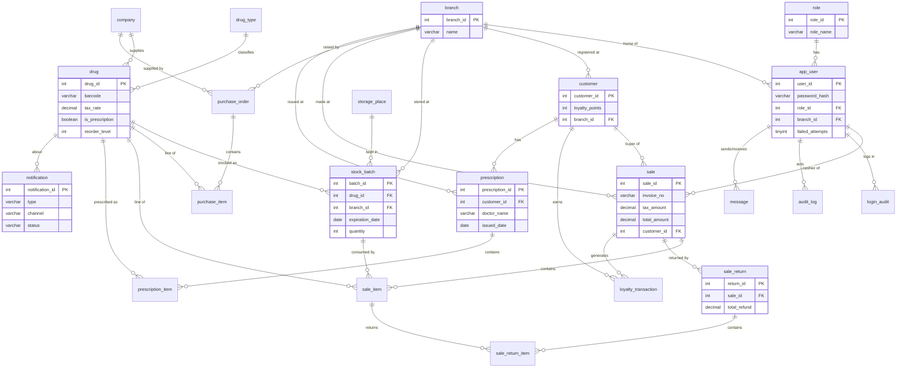
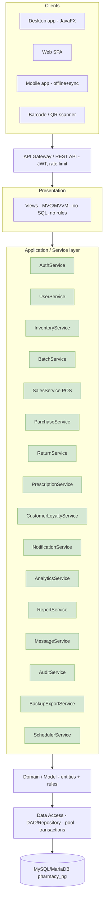
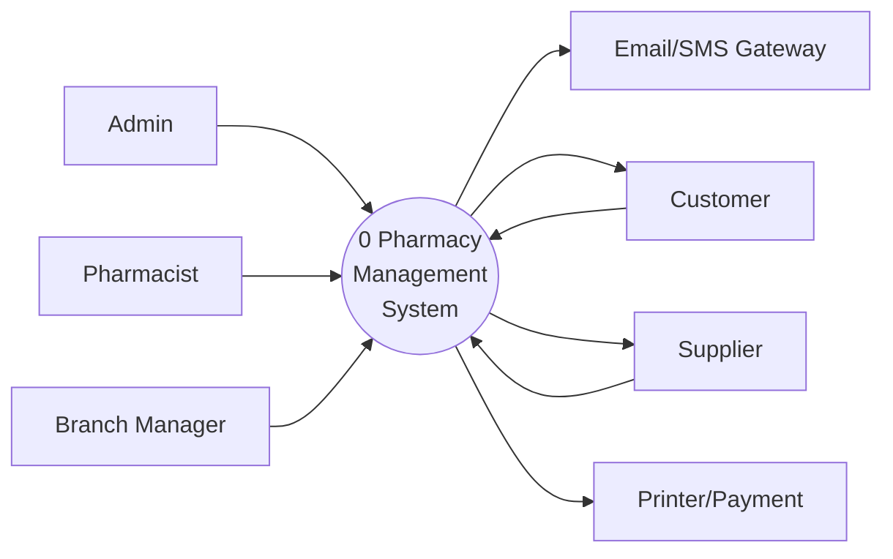
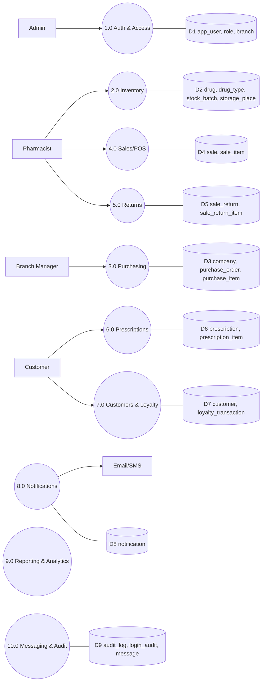
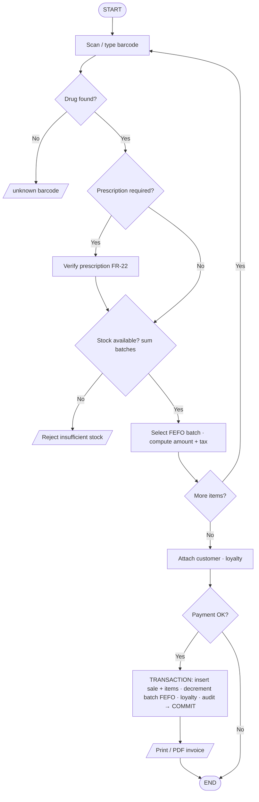
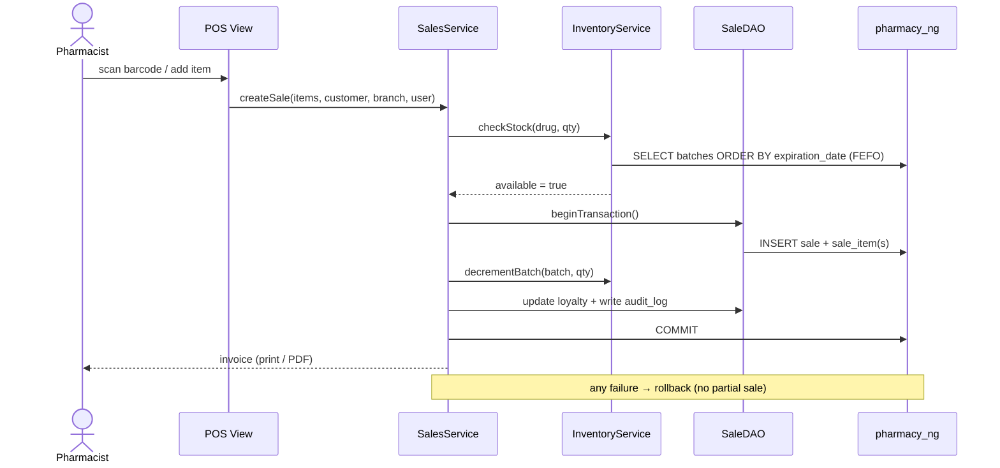
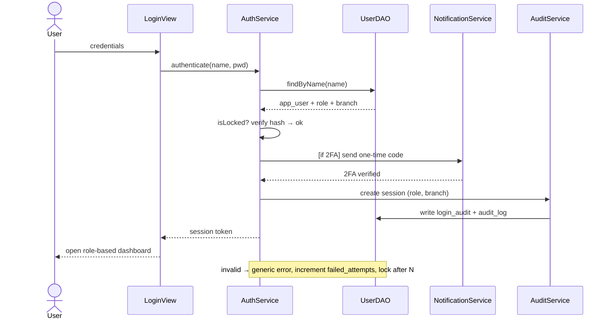

# Target-System Design Pack — Re-engineered Pharmacy Management System

**Design-only deliverables** for the **new (to-be)** system. No source code or SQL is produced —
the database is specified as a **schema design** (diagram + data dictionary).

> These diagrams sit alongside the **legacy/as-is** diagrams (`../` and `../current_system/`),
> which are kept unchanged for comparison. Only the *target* system is designed here.

## Files in this folder

| # | File | Diagram | What it shows |
|---|------|---------|---------------|
| 1 | `01_target_database_schema.drawio` | **New database schema** | 22 normalised tables + the tables added by the new features |
| 2 | `02_target_system_architecture.drawio` | **New system architecture** | Layered/N-tier + REST API + modern services (2 pages: layers, deployment) |
| 3 | `03_target_dfd.drawio` | **New DFD** | Context (level 0) + level-1 process/data-store decomposition |
| 4 | `04_target_flowcharts.drawio` | **New flowcharts** | POS sale, notifications, returns, prescription, PO approval |
| 5 | `05_target_use_case.drawio` | **New use-case diagram** | New actors + new use cases on top of the preserved ones |
| 6 | `06_target_designs.drawio` | **New designs** | Domain class diagram, sequence diagrams, state model |

**Open `.drawio` files** at <https://app.diagrams.net> (Open Existing Diagram), the draw.io desktop
app, or the VS Code *Draw.io Integration* extension; export to PNG/SVG/PDF for the report.

---

## New features added to the modernised system

| ID | Feature | Req. |
|----|---------|------|
| NC-01 | **Multi-branch / multi-store** support | FR-16 |
| NC-02 | **Barcode / QR scanning** & generation | FR-17 |
| NC-03 | **Automated expiry & low-stock notifications** (in-app / email / SMS) | FR-18 |
| NC-04 | **Analytics & BI dashboard** (trends, profit, top drugs, stock value) | FR-19 |
| NC-05 | **Customer management** + **loyalty programme** | FR-20, FR-21 |
| NC-06 | **Prescription management & dispensing** | FR-22 |
| NC-07 | **Sales returns & refunds** (with restock) | FR-23 |
| NC-08 | **Purchase-order workflow with approval** | FR-24 |
| NC-09 | **Tax / GST-compliant invoicing** (PDF / print) | FR-25 |
| NC-10 | **Data export & backup/restore** | FR-26 |
| NC-11 | **REST API / integration & offline-capable sync** | FR-27 |
| NC-12 | **Strong authentication**: reset, lockout, optional 2FA | FR-28 |

Full requirement text is in `../SRS_Target_System.md`.

---

## 1. New Database Schema (design)

22 tables in `pharmacy_ng`. **New tables/columns** are the ones that implement the new features.

**Data dictionary (new objects only):**

| Table / column | Purpose | Feature |
|---|---|---|
| `branch` | store/branch master | NC-01 |
| `app_user.branch_id`, `is_active`, `failed_attempts`, `locked_until`, `email` | branch scoping + lockout/reset | NC-01, NC-12 |
| `customer`, `loyalty_transaction` | customers + loyalty ledger | NC-05 |
| `prescription`, `prescription_item` | prescriptions & dispensing | NC-06 |
| `sale.customer_id`, `subtotal`, `tax_amount`, `discount`, `payment_method`, `status` | tax invoice + customer + returns status | NC-05, NC-07, NC-09 |
| `sale_item.batch_id`, `tax_rate` | FEFO consumption + tax | NC-02, NC-09 |
| `sale_return`, `sale_return_item` | returns/refunds with restock | NC-07 |
| `purchase_order.status`, `approved_by`, `approved_at` | PO workflow/approval | NC-08 |
| `drug.tax_rate`, `is_prescription`, `is_active`; `drug.barcode` widened | tax, Rx-only, soft-delete, EAN/QR | NC-02, NC-06, NC-09 |
| `notification` | expiry/low-stock alerts + channel/status | NC-03 |
| `audit_log`; `login_audit.ip_address`, `success` | action audit + stronger login audit | NC-12 |

## 2. New System Architecture

Dependencies point **downwards only**. Cross-cutting: config, logging, security/RBAC/JWT,
validation, error handling, caching, auditing, scheduling, i18n.

## 3. New DFD

**Level 0 (context):** external entities Admin, Pharmacist, **Branch Manager**, **Customer**,
**Supplier**, **Email/SMS Gateway**, **Printer/Payment**; one process = *Pharmacy Management System*.

**Level 1:** processes and data stores (D = data store):

## 4. New Flowcharts

Other target flowcharts (in the `.drawio`): **automated notifications**, **sales return/refund**,
**prescription dispensing**, **purchase-order approval**.

## 5. New Use-Case Diagram

```mermaid
flowchart LR
    Admin((Admin))
    Mgr((Branch Manager))
    Pharm((Pharmacist))
    Cust((Customer))
    Sup((Supplier))
    Sched((Scheduler))

    subgraph SYS["Pharmacy Management System (re-engineered)"]
      UC1((Login))
      UC2((Change Password))
      UC3((Reset Password / 2FA))
      UC4((Manage Users))
      UC5((Manage Branches))
      UC6((View Login History / Audit))
      UC7((Send / Read Messages))
      UC8((Manage Drugs))
      UC9((Manage Companies))
      UC10((Search / Scan Drug))
      UC11((Move Drug / Edit Price))
      UC12((Renew Validity / Restock))
      UC13((View Expiry / Stock Warnings))
      UC14((Create Sale / Bill POS))
      UC15((Manage Customers))
      UC16((Loyalty Points))
      UC17((Manage Prescriptions))
      UC18((Dispense Prescription))
      UC19((Record Purchase))
      UC20((Approve Purchase Order))
      UC21((Process Return / Refund))
      UC22((Analytics Dashboard))
      UC23((Export / Backup & Restore))
      UC24((Generate Notifications))
      UC25((Sync via REST API))
    end

    Admin --> UC1
    Admin --> UC4
    Admin --> UC5
    Admin --> UC6
    Admin --> UC22
    Mgr --> UC20
    Mgr --> UC5
    Mgr --> UC22
    Pharm --> UC8
    Pharm --> UC10
    Pharm --> UC14
    Pharm --> UC18
    Pharm --> UC21
    Pharm --> UC13
    Cust --> UC15
    Cust --> UC16
    Cust --> UC17
    Sup --> UC19
    Sup --> UC20
    Sched --> UC24
    Sched --> UC23
    Sched --> UC25
```

## 6. New Designs (class / sequence / state)

**Domain class model** (key classes): `Branch`, `Role`, `Company`, `DrugType`, `AppUser`, `Drug`,
`StoragePlace`, `Prescription`, `StockBatch`, `Customer`, `Sale`, `PurchaseOrder`, `SaleItem`,
`SaleReturn`, `PurchaseItem`, `Notification`, `LoyaltyTransaction`, `PrescriptionItem`,
`SaleReturnItem`, `Message` — full detail in `06_target_designs.drawio`.

**Sequence — POS sale (transactional, FEFO, tax, loyalty):**

**Sequence — login (hashed password, RBAC, optional 2FA):**

**State model — purchase order:** `DRAFT → SUBMITTED → APPROVED → RECEIVED`; `SUBMITTED/DRAFT → CANCELLED`.

---

## Summary — what the target design changes

| Aspect | Legacy | Target |
|---|---|---|
| Architecture | 2-tier monolith | Layered/N-tier + REST API (desktop/web/mobile) |
| Scope | single shop | **multi-branch** |
| Inventory | quantity on `drugs` | per-batch, FEFO, multi-branch |
| Sales | flat `sales` + `history_sales`, non-transactional | `sale` + `sale_item`, **atomic**, tax, customer |
| Extras | — | returns, prescriptions, loyalty, analytics, notifications, PO approval, backup, API |
| Security | plain text, injection, broken gate | hashed+salted, parameterised, RBAC, lockout/2FA, audit |
| Database | 10 flat tables, 1 FK | 22 normalised tables, full FKs, utf8mb4 |
